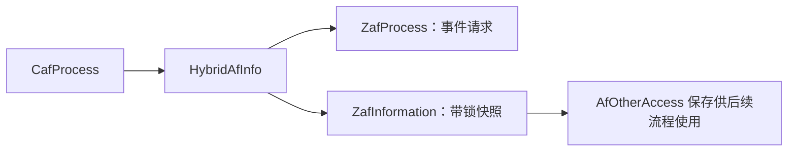

# GR IV 1.11 对焦控制、混合 AF 与镜头请求研究

## 结论与范围

2026-10-13 对本地解码固件重点检查对焦部分，追踪用户模式、公共属性、AF 仲裁、CAF/ZAF 协作、Snap 距离、对焦区域和镜头请求。

**固件中存在可追踪的混合 AF 协作代码，不能把对焦系统理解成一个 AF 开关。** `AfArbitrate` 绑定反差相关的 `CafProcess`、相位相关的 `ZafProcess` 和处理其他对焦请求的 `OtherafProcess`；`CafProcess` 通过 `HybridAfInfo` 启停 ZAF、请求处理并获取结果快照。模式编号、执行模块编号和远程控制编号是三个不同的编号空间。

本轮最明确的结果：

- 还原 16 个内部用户对焦编号到公共模式、远程编号的转换。其中 `SameAsShutter / None` 在这两条转换路径中进入诊断分支，不能当作普通拍摄模式写入。
- Snap 路径支持若干厘米距离，发送请求前转换为毫米；Infinity 保留 `0xFFFFFFFF` 哨兵。这些是代码支持的分支，不等于菜单全部开放。
- 原 AF 框尺寸函数中，MF、Snap、Infinity 返回零尺寸。336×216 属于 `AutoAreaM / ZoneSelect`，不能移植到 MF。
- 仲裁器在已有活动模块或待处理切换时拒绝新的模块切换。镜头控制另有拥有者检查和忙碌拒绝逻辑，直接调用一个驱动函数并不能绕过整个生命周期。
- ZAF 候选进入下一处理阶段前，检查预测结果有效、预测值边界、饱和、疑似伪峰和重复纹理标志。内部块上限 165 不等于已确认的 165 个用户对焦点；原始预测阈值 512 的物理单位未确认。
- 调试接口包含“返回 OK / NG 测试模式”，它改变测试状态，不是已证实的对焦性能优化选项。

证据包括 **48 个代码／数据窗口、40 条直接分支边、27 个精确字符串标记，以及 246 项有限原 ARM 指令检查**。未连接相机、操作 SD、改变相机 RAM 或固件；没有真实 AF 速度、精度、弱光表现或跟踪成功率数据，也没有确认一个可修复的实机对焦缺陷。

## 样本与复现

| 项目 | 值 |
| --- | --- |
| 机型 / 内部版本 | GR IV / 1.11.10.7（公开版本 1.11） |
| 原包长度 | 38,648,776 字节 |
| 原包 SHA-256 | `a2f664dfca034059eb0fd6e18ab08684c326b4a034d85c164dad7e1ec9b5655f` |
| 解码长度 | 67,948,280 字节 |
| 解码 SHA-256 | `c4e597c7c9ca1bc181b30e35139ed90a4fd876ddcca14f12be0e00b6702233ae` |
| RTOS 映射 | `decoded_offset = runtime_address − 0x53000000 + 0x17D10` |

以下地址均为上述样本的 RTOS 运行时映射地址，不是原压缩包偏移，也不是本轮实机读回地址。原包三个版本字段及整文件小端字和重新检查，字和模 `2^32` 为零；这不能用于推断升级签名机制。

```sh
python3 tools/inspect_firmware.py samples/fwdc248b.bin
python3 tools/audit_gr4_focus.py samples/gr4_decoded.bin --output /tmp/gr4-focus-static.json
python3 tools/check_gr4_focus.py samples/gr4_decoded.bin --output /tmp/gr4-focus-arm.json
```

[静态工具](../../tools/audit_gr4_focus.py)只依赖 Python 标准库，拒绝其他样本哈希，核对指纹、标记、分支和转换表。[ARM 检查工具](../../tools/check_gr4_focus.py)需要 Unicorn；使用原指令、合成对象和有界指令预算，拦截属性查询、诊断、距离请求、RTOS 事件标志以及 ZAF 相关／预测处理序列。块选择、字段读取、筛选分支和尺寸 helper 执行原指令。两者均只创建新的 JSON 文件，不覆盖既有结果，不含设备 I/O 或补丁生成。

本轮 Capstone 5.0.6 用于反汇编，Unicorn 2.1.4 用于有限执行。Darwin 沙箱内无法查询宿主缓存信息，ARM 验证经批准在沙箱外执行；仍仅操作本地文件与合成内存。原生跳转表逐项按小端 32 位地址解释，不能将表项显示的 `teqpl/cmppl` 伪指令当成实际执行代码。

本地证据位于被忽略的 `devkit-output/gr4-focus-20261013/`，包含 `static-audit-v2.json`、`native-arm-checks-v2.json`、早期 v1 结果、初次失败记录、字符串清单和工作反汇编；固件、派生反汇编与机身数据不纳入公开文档。

## 1. 用户模式、公共模式与远程编号

三个关键入口：

| 入口 | 代码行为 |
| --- | --- |
| `0x533F10DC` | 按字符串比较解析内部对焦名称，调用 UserData setter `0x532AECA4` |
| `0x5329D35C` | `FocusToFocusMode`，通过 16 项跳转表归并用户编号 |
| `0x5337C46C` | `UserDataFocusToCameraControlFocusMode`，通过另一张表转换为远程编号 |

| 用户 ID | 解析名称 | 公共模式 ID | 远程 ID |
| --- | --- | --- | --- |
| 0 | AutoArea | 1 | 0 |
| 1 | Select | 1 | 2 |
| 2 | SelectContinuous | 2 | 2 |
| 3 | SelectMovieRecording | 4 | 2 |
| 4 | Pinpoint | 1 | 3 |
| 5 | Follow | 3 | 4 |
| 6 | Continuous | 2 | 5 |
| 7 | MovieAf | 2 | 9 |
| 8 | MovieRecording | 4 | 9 |
| 9 | Mf | 0 | 6 |
| 10 | Snap | 0 | 7 |
| 11 | Infinity | 0 | 8 |
| 12 | SameAsShutter | 诊断 | 诊断 |
| 13 | None | 诊断 | 诊断 |
| 14 | AutoAreaM | 1 | 10 |
| 15 | ZoneSelect | 1 | 1 |

公共编号将多个 AF 区域／行为模式归并到同一运行类别。`AfOtherAccess` 的读取路径 `0x535E9D20 → 0x5375733C → 0x5375C814` 最终读取公共属性结构 `+0x714` 的字节；不能把这个字段的值直接解释为用户模式 ID。

`0x535E4094` 更新仲裁对象 `+0x78`，并将原值保存到 `+0x7C`：正常请求将公共 1 映射为 1、公共 2/3 映射为 2、公共 4 映射为 4；停止请求映射为 0，特殊请求 5/6 另有分支。**此处第三套运行状态同样不能直接替代 UserData 编号。**

诊断服务在 ARM 检查中被拦截并允许返回，因此无效输入测试观察到公共转换回退 1、远程转换回退 0。真实机身遇到断言后如何处理仍未验证。也没有将上述 16 个名称全部认定为当前菜单可选项。

## 2. AF 仲裁与模块切换

`AfArbitrate` 初始化入口 `0x535E3B70` 从三个工厂取得执行对象，并通过诊断字符串确认字段身份：

| 仲裁对象字段 | 对象 | 工厂 / 读取 |
| --- | --- | --- |
| `+0x48` | AfCyclic | AfCommonFactory `+8` |
| `+0x4C` | AfFactoryCommand | AfCommonFactory `+0xC` |
| `+0x50` | AfLensControl | AfCommonFactory `+0x10` |
| `+0x54` | AfOtherAccess | AfCommonFactory `+0x14` |
| `+0x58` | CafProcess | `0x535ED004`，工厂 `+4` |
| `+0x5C` | OtherafProcess | `0x5360DF6C`，工厂 `+4` |
| `+0x60` | ZafProcess | `0x53612658`，工厂 `+0x2CC` |

`GetAfProcessAddress` 位于 `0x535E4000`：执行模块 ID 1、2 **均返回 CafProcess**；3 返回 ZafProcess；4 返回 OtherafProcess。无效 ID 输出错误诊断并保留 CAF 默认指针。这说明固件中的旧名称或编号不能单独证明 GR IV 使用另一套独立 AF 硬件。

控制请求入口 `0x535E5238` 的分支 2 进入 `0x535E4264`。后者仅当仲裁对象 `+0x84`（活动模块 ID）和 `+0x88`（待处理模块 ID）均为零时，写入新的待处理模块并设置 `+0x24` 事件对象的位 2；其他情况下返回 0，不覆盖当前状态。`0x535E4598` 进一步通过模块选择函数和虚方法调度请求。

这是**忙碌保护和异步调度的代码证据**，不是对真实线程安全、竞态消除或事件交付的完整证明。单独写字段或调用 CAF/ZAF 入口可能破坏原有流程，不能据此形成可上机的调用方案。

## 3. CAF 与 ZAF 的协作

这里把 CAF 称为反差相关模块，依据其水平／垂直反差数据、亮度、搜索脉冲、峰值检测及 wobbling 代码；把 ZAF 称为相位相关模块，依据波形相关、defocus、可靠性与 PDAF 采集／校正模块。ZAF 与全部传感器通路的逐级映射尚未完成，不将类名本身视为实机启用证据。

已追到的协作关系：



| 地址 / 调用边 | 可确认的行为 |
| --- | --- |
| `0x535ECC58` | HybridAfInfo 初始化：保存 ZafInformation 到 `+4`、ZafProcess 到 `+8` |
| `0x535FD318 / 0x535FD324 → 0x535ECD80` | CAF 对 ZAF 状态作两次转换请求 |
| `0x535ECD80 → 0x53619BB4` | 输入 0/1 转换为 ZafProcess 的 1/0；改变 `+0x78`，向 `+0x38` 事件对象设置 `0x40000` |
| `0x535FD754 → 0x535ECDA8 → 0x5361A678` | CAF 经 Hybrid 请求 ZAF：更新局部状态，调用 Operation，再设置 ZAF 事件位 |
| `0x536019A8 → 0x535ECD60 → 0x53612DD8` | CAF 转换流程调用 ZAF 结果快照方法 |
| `0x535EADE8 → 0x535ECD78 → 0x53612ED4` | 查询快照是否有效，并选择不同快照读取方法 |
| `0x535ECD58 → 0x53612D84` | 在锁内复制 `0x770` 字节的 ZAF 信息快照 |
| `0x535ECD68 → 0x53612E30` | 在锁内读取另一份 `0x770` 字节结果；有效字节在相关缓冲起点 |

`0x53612DD8` 在锁内复制同尺寸的数据并将目标首字节置 1；`0x53612ED4` 在锁内检查相关首字节是否为 1。由此可以确定快照发布／有效性协议，不能将每次复制等同于一个真实有效的传感器测量。

ZafFactory 初始化还绑定 `ZafCorrelation / ZafDefocus / ZafFilter / ZafLensInfo / ZafOperation / ZafOperationAccessor / ZafOperationAlgorithm / ZafOperationConfig / ZafOperationSequence / ZafPredictor / ZafWaveData`。固件诊断包含 `ZafReliability`、`ZafDefocusUm`、近／远搜索方向、饱和与缺陷备份；CAF 也有眼／脸峰值和候选区域相关输出。这提供后续研究可靠性判据与搜索回退的入口，**尚未给这些字段建立完整单位、阈值和帧级时序。**

值得区分的配置表：`0x5361130C` 按 ProjectType 从 `0x53EAB62C` 读取七个字节 `[1,0,2,2,3,2,2]`，越界返回 0；标准 GR IV 的默认 ProjectType 2 选择值 2。这是多值项目选择数据，不是布尔式“相位 AF 开／关”。`CaptureZafInterface` 的 `0x5385ED68` 则绑定 `CapturePpuPdspService`；采集接口与算法的完整数据流仍需补齐。

## 4. Snap、Infinity 与搜索范围

`FocusModel::ApplySnapDistance` 位于 `0x5339DBC8`。它先取 Snap 距离，再检查视频标志和当前用户对焦模式：视频标志非零返回 0；模式 10 进入距离分支；模式 11 直接使用无穷远哨兵；其他模式返回 0。

| 分支输入（厘米） | 向 `0x5339D3B0` 发送的距离参数 |
| --- | --- |
| 30 / 40 | 300 / 400 毫米 |
| 100 / 150 / 200 / 250 | 1000 / 1500 / 2000 / 2500 毫米 |
| 350 / 500 | 3500 / 5000 毫米 |
| `0xFFFFFFFF` | 原样保留无穷远哨兵 |
| 其他值 | 诊断分支，返回 0 |

模式 11 与模式 10 的无穷远分支均发送 `0xFFFFFFFF`；这不是可直接转换为一个电机脉冲值的有限距离。

后续 `0x5339D3B0` 与公共距离状态比较，通过 `0x5339D074` 更新相关 UserData，再发出 `0x4241080B` 消息。毫米距离请求与镜头驱动脉冲之间还存在数据构建、校正和状态处理，不能使用上述表直接给电机指定位置。

两组范围解析器也不同：

| 入口 | 解析结果 |
| --- | --- |
| `0x533F2814` | `OnlyNear / OnlyFar / Off → 0 / 1 / 2`，调用 `0x532B0D2C` |
| `0x533F294C` | `10cmToInfinity / 10cmTo50cm / 50cmToInfinity → 0 / 1 / 2`，调用 `0x532B1044` |

前者最终写入 UserData `+0xF4`，后者写入 `+0xF6`，备份字段分别为 `+0xBE0 / +0xBE2`。不能因为二者都使用 0–2，就认为它们是同一字段。镜头实际行程限制的消费者尚未完整追踪，当前没有给出超出原菜单范围的设置修改或隐藏选项解锁方案。

## 5. 对焦框与画幅坐标

`GetFocusAreaSize` 位于 `0x5339E894`，输入用户模式 ID，使用原生尺寸对象 helper。`UpdateCommonPropertyFocusArea` 位于 `0x5339EE20`，调用前者，以 `720 / 480` 作为居中计算基准，并向公共属性发布区域信息。

| 用户模式 | 普通原生比例 ID 0/1/2 的尺寸 | 原生比例 ID 3 的尺寸 |
| --- | --- | --- |
| AutoArea（0） | 560×360 | 480×360 |
| AutoAreaM / ZoneSelect（14/15） | 336×216 | 288×216 |
| Select / SelectContinuous / SelectMovieRecording / Follow / Continuous（1/2/3/5/6） | 64×52 | 64×52 |
| Pinpoint（4） | 32×32 | 32×32 |
| MovieAf / MovieRecording（7/8） | 590×380 | 590×380 |
| Mf / Snap / Infinity（9/10/11） | **0×0** | **0×0** |
| SameAsShutter / None（12/13） | 诊断 | 诊断 |

原画幅顺序表 `0x53DBB034` 为 `[0,1,3,2]`，对应既有 3:2 / 4:3 / 1:1 / 16:9；表中的 ID 3 是方形。只有需要画幅查询的分支检查比例 ID `<=3`，这不是所有小窗口分支都会检查第五项的保证。

本表表示 **FocusModel 的区域计算**，不是传感器 AF 像素数量、LCD 实测尺寸或 ZAF 像素坐标。MF 返回零尺寸也不表示没有 MF 辅助、峰值显示或距离表；只是这一自动对焦区域函数没有赋予它一个普通 AF 框。

对现有 XPAN 研究的直接影响：新增原生比例值 4 会在相关 FocusModel 分支进入诊断；仅添加取景遮罩不能证明 AF 框、触摸位置与有效成像窗口一致。需要追踪区域属性消费者及 CAF/ZAF 坐标变换后才能接入。

## 6. 镜头拥有者、异步请求与校正

`AfLensControl` 初始化 `0x535E8EF0` 绑定 `AfAdjust`、`LensDataBuilder`、`LensFocusControl`、`LensState`，说明算法请求与驱动之间还有镜头状态／校正层。

- `0x535E900C` 检查 `AfLensControl +0x14` 的拥有者。原值零时保存请求者并返回 1；非零时只接受相同请求者，不覆盖其他拥有者。
- `0x535E9034` 比较拥有者编号，匹配后才调用 `LensFocusControl::request` 的候选入口 `0x539290FC`。
- `0x539290FC` 检查对象 `+0xCC` 忙碌字节。非零返回 1，不改变请求结构；空闲时保存命令、参数、忙碌与新请求标志，再向 `+0x4C` 事件对象设置位 1，返回 0。
- `0x5392D11C` 根据参数 0/1/2 和对象 `+0x78` 的索引读取三套浮点温度系数表；参数越界进入诊断。`GetHpSignal`、绝对／相对脉冲纠正和校正数据类也存在有代码引用的入口。

ARM 检查确认拥有者与忙碌保护的返回值和合成对象变化；RTOS 事件服务为模拟。**尚未执行真实电机任务、确定命令单位、验证脉冲到光学距离标定或测量温度补偿效果。** 驱动排队成功不代表对焦完成。

## 7. 调试功能及验证结果

`0x53022730` 附近的处理函数解析 `EnableAfDebugDataSave <0/1> [P/C/Z/O]`，设置 AfOtherAccess 对象 `+0x27…+0x2A` 的保存标志，Z 分支还调用 ZafProcess 的数据保存配置。它与 AF 路径选择是不同功能，可能涉及存储开销；本轮没有执行该命令。

`0x53022850` 的处理函数把参数保存到仲裁对象 `+0x1DB`，根据 0/1/2 输出关闭、OK 测试、NG 测试日志。`0x535E5D00` 存在消费该字段的执行分支并改变局部测试状态。**不能把日志中的 OK 解释为提高实际对焦可靠性，或据此关闭正确的失败检测。**

246 项原 ARM 检查分布：

| 范围 | 数量 | 验证内容 |
| --- | --- | --- |
| 公共／远程转换 | 34 | 16 个 ID 和越界 ID，含诊断回退 |
| 模块指针选择 | 7 | 1/2 共用 CAF、3 为 ZAF、4 为 Otheraf 及无效输入 |
| 仲裁模式归并 | 20 | 五种公共模式与普通／停止／特殊请求 |
| 模块切换保护 | 24 | 活动／待处理状态的接受和拒绝，保留原字段 |
| Snap / Infinity | 13 | 有限距离、哨兵、错误值、视频和非 Snap 模式 |
| AF 区域尺寸 | 68 | 16×4 组合及四个比例越界分支情况 |
| 镜头拥有者 | 16 | 空闲认领、同一拥有者、冲突拒绝 |
| 镜头排队 | 3 | 空闲发布与两种非零忙碌值不写 |
| ZAF 块边界 | 32 | 四种项目变体的起点、长度、越界与相关窗口边距 |
| ZAF 块数量 | 4 | 0、165、166 与全部启用分支，含越界诊断 |
| ZAF 候选筛选 | 20 | 第 0/164 块的预测 ±512/±513 边界，以及四种异常标志和禁用块 |
| ZAF 可靠性字段 | 5 | 254/255/256、预测无效、重复纹理时的字段写回 |

首次 ARM 检查暴露了分析工具期望值的错误：初稿误把跳转表中的零尺寸返回分支归给 14/15、把 336×216 归给 MF/Snap/Infinity。逐项读取原表地址并执行原 ARM 后已纠正；两次失败记录保留。**这是分析期望的修正，不是发现或修复固件缺陷。** v1 的 185 项及扩展后 v2 的 246 项均全部通过，静态指纹仍与原样本一致。

## 8. ZAF 块选择与结果筛选边界

`ZafOperation` 的任务入口 `0x53614B98` 在对象 `+0x48` 活动时，依次调用算法块初始化 `0x53616868`、候选处理 `0x53616C94`、后处理 `0x53617174`，然后进入信息收集器。算法对象保存 accessor、config、sequence 及项目变体；块记录通过 accessor 指针表读取，合法索引为 0–164。

选择入口 `0x53616850` 按配置分派到全部启用 `0x53616704` 或选择性启用 `0x53616754`。后者先核对配置块数上限 165，再读取记录中的有符号起点与无符号长度。起点必须非负；非零长度时，最后一个样本 `start + length − 1` 必须小于项目对应的 profile 宽度。

| 项目变体 | profile 宽度（表 `0x53EAB534`） | 原始预测值绝对值上限（表 `0x53EAB52C`） |
| --- | --- | --- |
| 0 / 1 | 251 | 512 |
| 2 / 3 | 453 | 512 |

标准 GR IV 的默认项目选择值为 2。这里的 251/453 是内部 profile 的边界参数，不是 LCD 坐标或已确认的传感器像素宽度；165 是记录容量／循环上限，不能据此称为 165 个用户 AF 点。原窗口 helper `0x5361528C` 在有效输入上把边距限制为 `min(11, start, width − start − length)`，写入三组相关窗口长度和偏移。32 项边界检查执行了这些原始读写指令。

候选处理 `0x53616C94` 先跳过未启用块，再请求 sequence 类型 0。该请求成功返回到普通分支时，只有下列条件同时满足，才请求 sequence 类型 2：

| 原记录字段 | 原 getter | 放行条件 |
| --- | --- | --- |
| `+0x3D` | `GetPredictorOkBackup`，`0x53615BE8` | 非零 |
| `+0x3E`（有符号 16 位） | `GetPredictorBackup`，`0x53615C94` | 绝对值 ≤ 项目阈值 512 |
| `+0x46` | `GetZafSaturationBackup`，`0x53615F44` | 零 |
| `+0x45` | `GetFakeBottomDoubtBackup`，`0x53615E98` | 零 |
| `+0x44` | `GetRepetitionDetectedBackup`，`0x53615DEC` | 零 |

因此 ±512 通过该边界，±513 被拒绝；饱和、疑似伪峰、重复纹理或预测无效也阻止这一次类型 2 请求。这是**进入下一算法阶段的条件**，尚未等同于最终合焦、ZAF 对 CAF 的全局回退或真实光学可靠性。类型 0 返回非零时另有重复纹理检测路径，当前 ARM 检查将 sequence 固定为返回零，没有执行那一分支或相关／预测算法本身。

后处理 helper `0x53616E48` 还读取可靠性备份中的半字字段（记录 `+0x2E`）：值大于 255、预测无效或重复纹理时写成 255，否则保留原值。255 本身也能被保留，因此不能仅凭这一写回就把 255 定义为全流程统一的“无效置信度”；下游解释仍需追踪。

本节确认了数值边界和若干筛选条件，**尚未确认预测值 512 的物理单位、profile 与相位采样的映射、各标志的完整生成规则，或这些条件对弱光和追焦速度的实际影响**。没有证据支持直接放大阈值、跳过筛选来提高对焦性能。

## 尚未解决的问题

1. **混合 AF 何时切换／回退。** 已确认协作入口、快照、事件请求及一层 ZAF 候选筛选；仍需还原 CAF/ZAF 状态位、异常标志生成、可靠性聚合、计时单位及弱光处理，不能给出完整切换条件公式。
2. **相位采样的数据流。** 需要连接 CaptureZafInterface、PDSP/PDAF 校正、像素缺陷／遮光表与 ZafWaveData，区分当前 ProjectType 的格式及可达分支。
3. **对焦慢在哪里。** 尚无分阶段时间：传感器统计准备、算法搜索、镜头行程与稳定等待、最终确认分别耗时多少。先做这些观测才有依据评价修改方向。
4. **跟踪与人脸／眼睛。** 找到相关消费者和诊断入口，但没有完成目标选择、丢失恢复和预测器的全链路分析；字符串存在不等于每项功能在 GR IV 上开放。
5. **区域与实际像素对应。** 720×480 模型坐标、活动画幅、触摸坐标、CAF 区域、ZAF 分块尚未统一验证，尤其是 XPAN 等新画幅。

现阶段可继续研究的明确起点是 `0x535FD5E8 / 0x535F6670 / 0x53601914` 的 CAF 状态处理、`0x53618A84` 的 ZAF sequence 与 `0x53616ED8` 附近的可靠性聚合，以及 CaptureZafInterface 到 ZafWaveData 的采样流。本报告没有提供可刷的对焦补丁或经过实机证明的“提速参数”。
